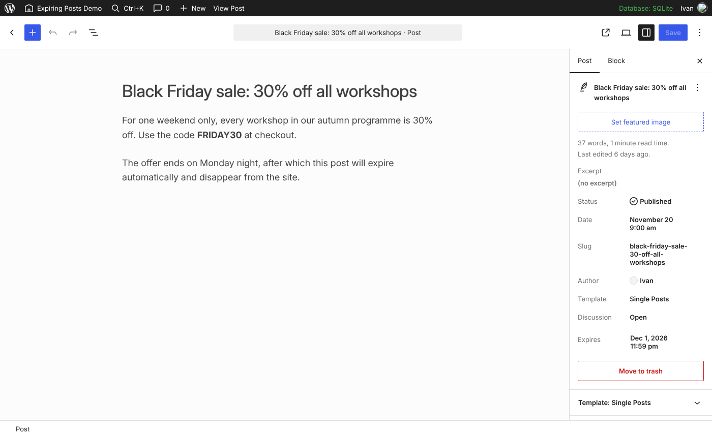
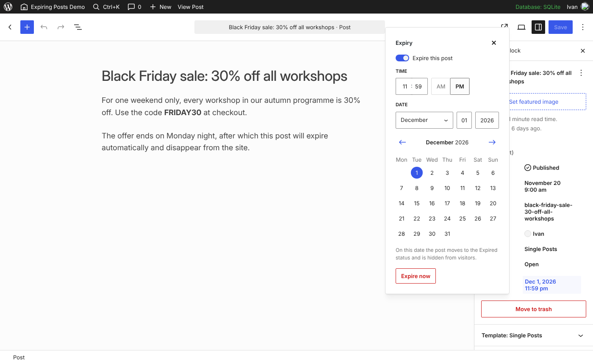
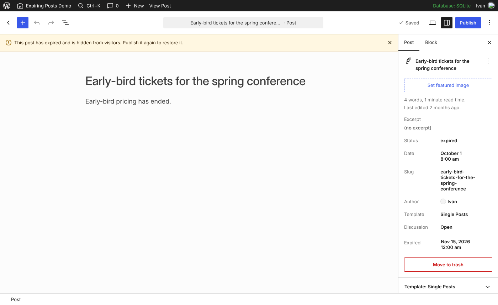
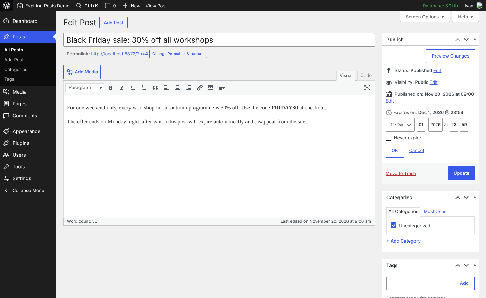
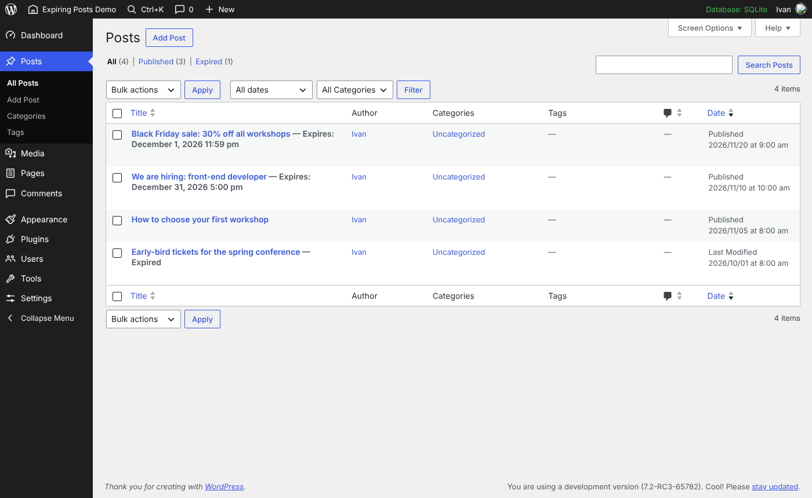

# Expiring Posts


Pick a date and a post moves to an **Expired** status automatically. Works in the block editor and the classic editor.

[WordPress.org plugin page](https://wordpress.org/plugins/expiring-posts/) · Requires WordPress 6.6+ and PHP 7.4+ · Tested up to WordPress 7.2 and PHP 8.6

When the date arrives, the post is hidden from visitors, search and feeds. Nothing is deleted: expired posts stay in the admin under the *Expired* view, editors can still preview them, and publishing one again puts it back online.

## Block editor

The expiry date sits in the post sidebar, next to Status and Date:



Turn expiry on, pick a date and time, or expire the post straight away:



An expired post shows a notice. Publish it again to restore it:



## Classic editor

Set the expiry date in the Publish box, just like the publish date:



## Post list



## How it works

- Only published, scheduled and private posts expire. Drafts and pending posts are left alone.
- Only users who can publish a post can change its expiry.
- A single WP-Cron event is scheduled for the next post that is due. If you set `DISABLE_WP_CRON`, make sure a real cron job calls `wp-cron.php`.
- All dates use the site timezone (**Settings → General**).
- Republishing an expired post whose date has passed turns expiry off, so it doesn't expire again straight away.

## Developer notes

- Post status: `expired`.
- Post meta (protected, so hidden from the Custom Fields box): `exp_expiration_date` (site timezone, `Y-m-d H:i:s`) and `exp_pending_expiration` (`1` when expiry is on).
- REST API: the `expiring_posts` field on supported post types, in the `edit` context.

  ```http
  POST /wp-json/wp/v2/posts/123
  { "expiring_posts": { "enabled": true, "date": "2026-12-01T23:59:00" } }
  ```

  Dates are in the site timezone. Dates with a UTC offset (`Z`, `+02:00`) are converted.

### Functions

| Function | Description |
| --- | --- |
| `exp_expire_post( $post, $timestamp = false )` | Set a post to expire at a Unix timestamp. Without one it expires now. |
| `exp_unschedule_expiring_post( $post )` | Turn expiry off. |
| `exp_get_expiration_timestamp( $post = null )` | Expiry as a Unix timestamp, or `false`. |
| `exp_get_expiration_date( $post = null, $format = '' )` | Formatted expiry date, or `''`. |
| `exp_the_expiration_date( $format = '', $before = '', $after = '' )` | Print the current post's expiry date. |

Shortcode: `[expiring_posts_date format="F j, Y" none="Never expires"]`.

### Filters

| Filter | Arguments | Description |
| --- | --- | --- |
| `exp_disable_expiration_for_this_post` | `bool $disabled, int $post_id` | Return `true` to hide the controls and stop a post from expiring. |
| `exp_supported_post_types` | `string[] $post_types` | Post types that can expire. |
| `exp_expirable_post_statuses` | `string[] $statuses` | Statuses that can move to Expired. Default `publish`, `private`, `future`. |
| `exp_user_can_manage_expiration` | `bool $can, WP_Post $post` | Who can change a post's expiry. |
| `exp_expired_post_status_args` | `array $args` | Arguments for `register_post_status()`. |
| `exp_expire_batch_size` | `int $size` | Posts expired per cron run. Default 100. |
| `exp_get_expiring_posts` | `array $posts` | Post ID => timestamp list used for scheduling. |

### Actions

| Action | Arguments | Description |
| --- | --- | --- |
| `exp_post_expired` | `int $post_id, string $old_status` | After a post expires. |
| `exp_expire_post` | `int $post_id, int $timestamp` | After `exp_expire_post()` sets a date. |
| `unschedule_expiring_post` | `int $post_id` | After expiry is turned off. |

## Development

No build step: the block editor script is plain JavaScript using the `wp.*` globals.

```sh
# Coding standards (WordPress Coding Standards + PHPCompatibilityWP)
phpcs
```

Release assets (banner, icon, screenshots) live in `.wordpress-org/`. `.distignore` lists what to leave out of the plugin zip.

## License

GPL-2.0-or-later.
